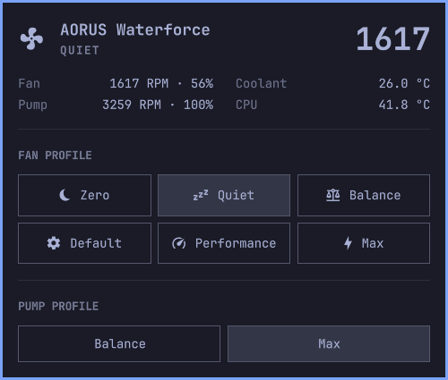

# AORUS Fan Control (Omarchy plugin)



Bar widget for the Gigabyte AORUS WATERFORCE X AIO cooler (USB `1044:7a4d`).
Click the fan icon to pick a fan profile (Zero, Quiet, Balance, Default, Performance, Max)
and a pump profile (Balance, Max), with live fan/pump RPM, coolant and CPU temperature.
Keyboard: arrows move between the fan and pump buttons, Enter applies, Esc closes.

## Supported hardware

| Cooler | USB ID | Status |
|---|---|---|
| AORUS WATERFORCE X 360 | `1044:7a4d` | Tested by the maintainer |

That is the only cooler this has been verified on. Other WATERFORCE X models, or anything else
that reports the same USB ID, may work, but nobody has confirmed it. If you have one, please
test it and open a [hardware report](https://github.com/D05Col/omarchy-aorus-fan/issues/new?template=hardware-report.yml) with what you
see. Reports that work get added to the table above; reports that don't help find what differs.

To test, run `lsusb | grep 1044`, then `aorus-fan status --json` (see [CLI](#cli)), then try each
fan and pump profile and check the RPM follows.

## Install

```bash
omarchy plugin add <git-url> --enable
```

Reading status works out of the box. Changing a profile means writing raw HID reports to the
cooler's `/dev/hidraw*` node, which is root-only by default, and the `gigabyte_waterforce`
kernel driver is read-only. Until that is set up, the panel shows an **Authorize fan control**
button instead of the profile buttons. Clicking it (or pressing Enter) asks for your password
through polkit and runs one short `sh -c` command as root: it writes the udev rule below to
`/etc/udev/rules.d/70-waterforce.rules` and reloads udev. The command is fixed in
`BarWidget.qml` and the polkit dialog shows it, so you can see what you are approving. The
rule tags only this device (USB `1044:7a4d`) with `uaccess`, so the logged-in user, and nobody
else, can write to it. It is a one-time step and the button goes away afterwards.

```
SUBSYSTEM=="hidraw", ATTRS{idVendor}=="1044", ATTRS{idProduct}=="7a4d", TAG+="uaccess"
```

To do the same from a terminal:

```bash
echo 'SUBSYSTEM=="hidraw", ATTRS{idVendor}=="1044", ATTRS{idProduct}=="7a4d", TAG+="uaccess"' |
  sudo tee /etc/udev/rules.d/70-waterforce.rules
sudo udevadm control --reload-rules
sudo udevadm trigger --subsystem-match=hidraw --action=change
```

The file name matters: `uaccess` rules must sort before `73-seat-late.rules`.

## Uninstall

```bash
omarchy plugin remove dylan.aorus-fan
sudo rm /etc/udev/rules.d/70-waterforce.rules
sudo udevadm control --reload-rules
rm -rf ~/.local/state/aorus-fan
```

Your write access to the cooler stays until the cooler is replugged or the machine reboots,
because udev does not strip an already-applied permission when a rule is removed.

## Settings (`shell.json` entry)

- `restoreOnStart` (default `true`): re-apply the saved profile once per boot when the
  shell starts. The profile is saved in `~/.local/state/aorus-fan/state.json`.

## CLI

All device logic is in `bin/aorus-fan` (stdlib Python, no dependencies); the QML is only UI.
Link it into your `PATH` to use it from a terminal:

```bash
ln -s ~/.config/omarchy/plugins/dylan.aorus-fan/bin/aorus-fan ~/.local/bin/aorus-fan

aorus-fan status [--json]            # RPM, duty, coolant and CPU temp, saved profile
aorus-fan set quiet [--pump max]     # zero | quiet | balance | default | performance | max
aorus-fan set --pump max             # change only the pump; the fan keeps its saved profile
aorus-fan restore                    # re-apply the saved profile once per boot
```

## Protocol notes

Report ID `0x99`, 6144-byte reports written to the device's `/dev/hidraw*` (found by USB ID
under `/sys/class/hidraw`, never hardcoded). The `gigabyte_waterforce` kernel driver keeps
running, so telemetry is read from its hwmon device, falling back to the status query below.

- Status query `{0x99, 0xDA}`: fan RPM `[2..3]`, pump RPM `[5..6]` (little-endian), fan duty
  `[8]`, pump duty `[9]`, coolant `[13]` + `[14]/10` °C.
- Profile change: `{0x99, 0xE5, 0x01, fan}`, `{0x99, 0xE5, 0x02, pump}`, then the commit
  `{0x99, 0xB6}`, about 20 ms apart. Without the commit nothing persists.
- Fan codes: `0x07` zero, `0x06` quiet, `0x00` balance, `0x02` default, `0x05` performance,
  `0x04` max. Pump: `0x00` balance, `0x04` max.
- Do not send `0xE6` manual curves: the firmware latches into ~88% duty (Performance).
- Measured on one WATERFORCE X 360 at 26 °C coolant, ~50 °C CPU: quiet 56% (~1,450 RPM), balance 72%
  (~1,800), performance 88% (~2,270), max and default 100% (~2,600). `default` is not a
  gentle curve on this unit.

## License

MIT
